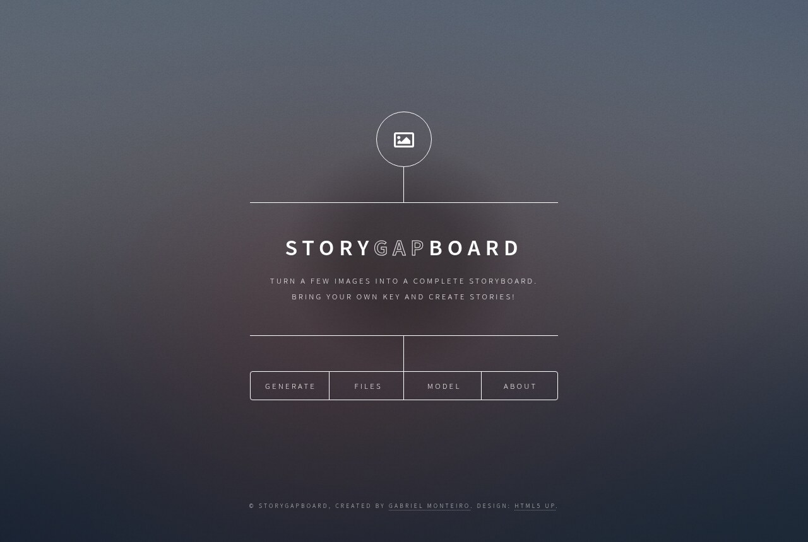
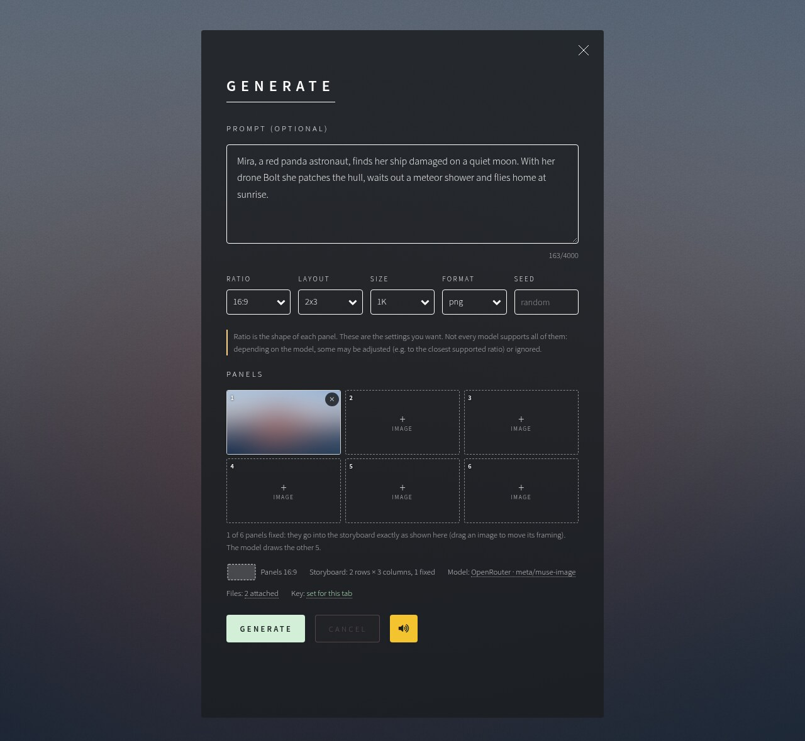
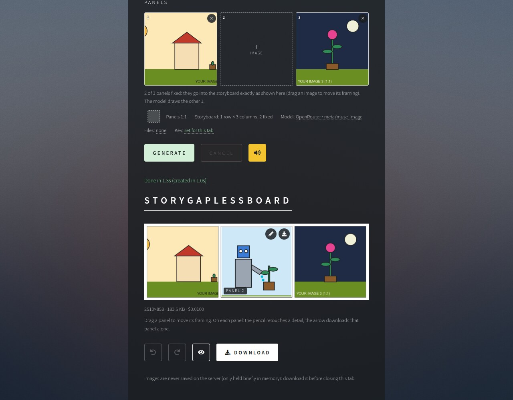
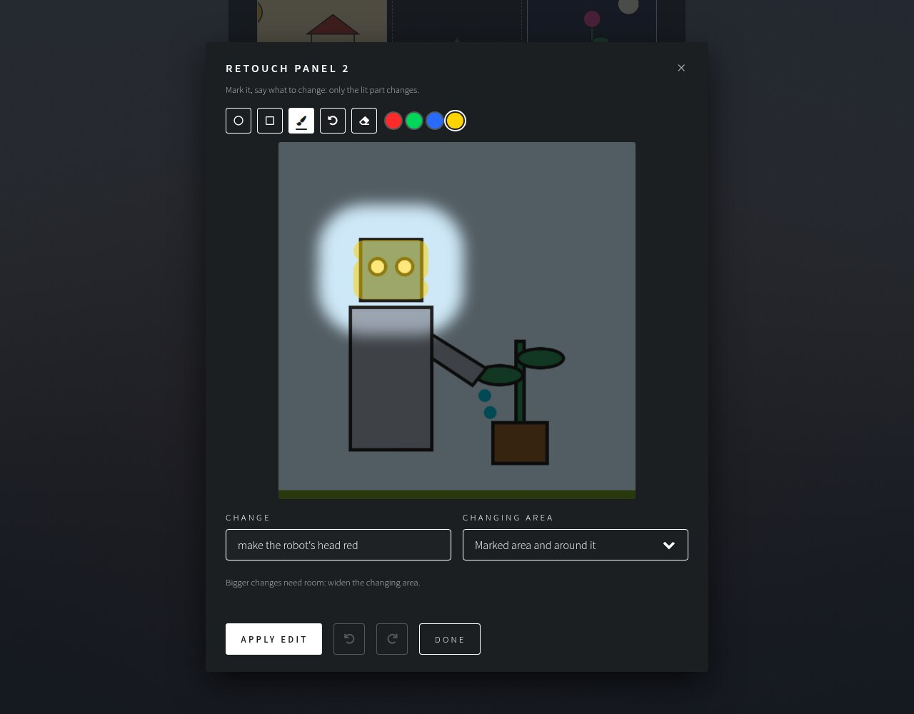
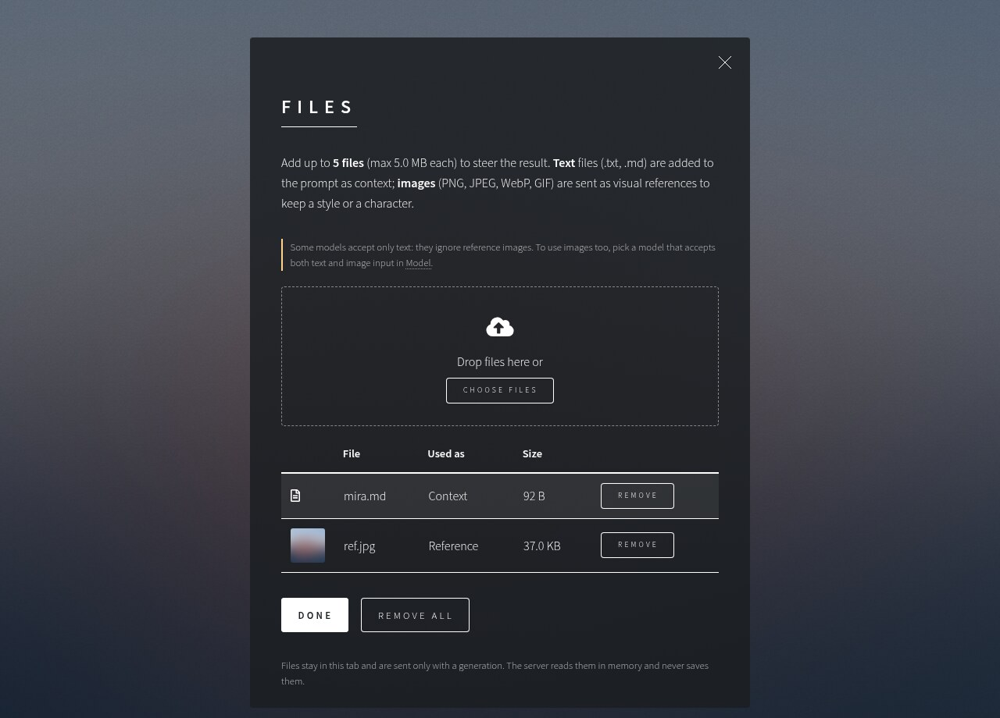
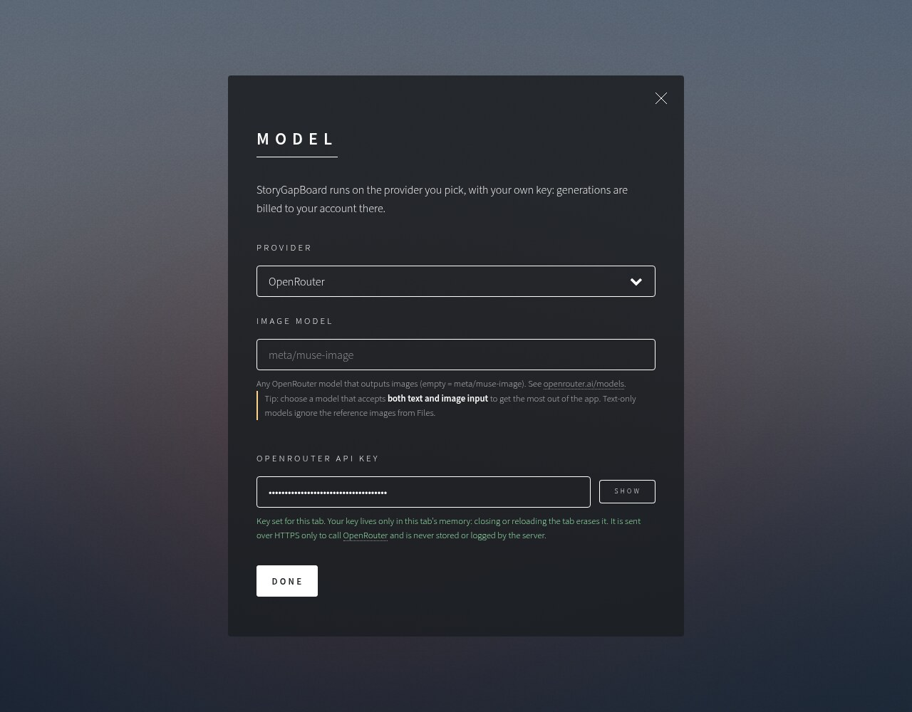
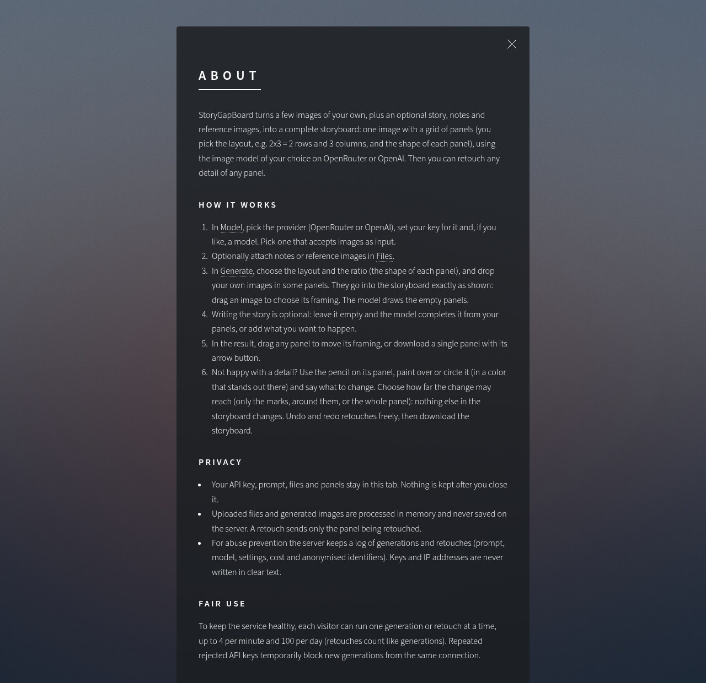
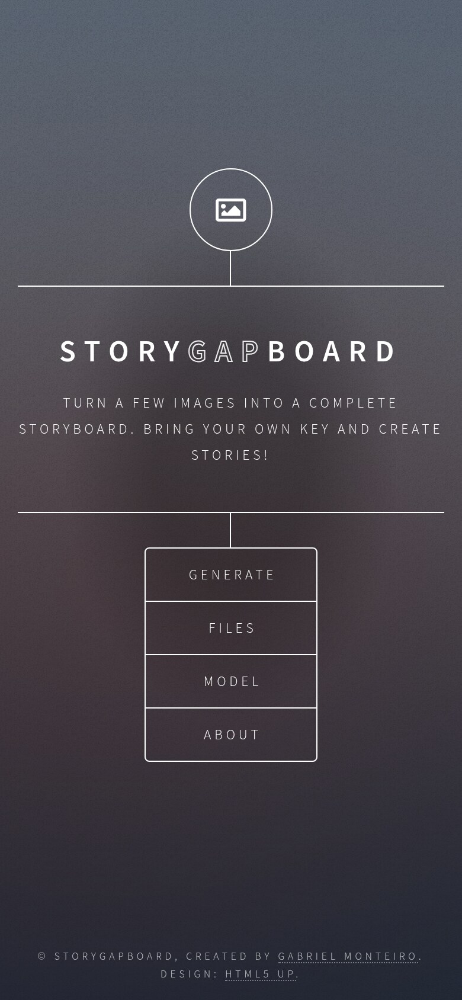

# StoryGapBoard

🎬 Turn a short story, plus optional notes, reference images and panels of your own, into a **storyboard**:
one image with a grid of panels, made by an image model on [OpenRouter](https://openrouter.ai) or
[OpenAI](https://developers.openai.com/api/docs/guides/image-generation). Then
retouch any detail of one panel without touching the rest. Visitors use their own API key.



## ✨ Features

- ✍️ **Generate**: optional story (leave it empty and the model completes the story from your panels),
  layout (1x3, 1x6, 2x1, 2x2, 2x3, 3x1, 3x2), panel ratio (the shape of each frame: 1:1, 4:3, 3:4, 3:2,
  2:3, 4:5, 16:9, 9:16, 21:9 or auto), size, download format and seed.
- 🧩 **Panels**: the layout as boxes, in the chosen panel shape. Drop your own image in some of them (drag
  it to pick the framing when its shape differs): it goes into the storyboard exactly as shown and the
  model draws the empty ones.
- 🖼️ **The storyboard**: every panel in the exact chosen shape, with a margin and a thin frame. Drag any
  panel to move its framing (also the ones the model drew), download a single panel, undo/redo, and a
  new generation asks before replacing the current one.
- 🖌️ **Retouch**: the pencil on a panel opens it. Mark the detail with a circle, a rectangle or the brush
  (thin, medium or thick), in a mark color that stands out on that panel, and say what to change. A live
  preview darkens what stays and lights what may change (only the marks, around them, or the whole
  panel). The answer is lined up and blended in the browser, so nothing else changes. Undo and redo per
  panel.
- 🤖 **Model**: OpenRouter or OpenAI, the image model and your key for it.
- 📎 **Files**: up to 5 files (5 MB each).
  - 📝 `.txt` / `.md` → story context
  - 🎨 PNG / JPEG / WebP / GIF → visual references
- ℹ️ **About**: how it works, privacy and fair use.

🧭 **How it works**: the full pipeline (diagrams and every step with an example) and a walkthrough with
real files in [examples/](examples/README.md).

## 📸 Screenshots

| Generate | Storyboard |
|---|---|
|  |  |
| **Retouch** | **Files** |
|  |  |
| **Model** | **About** |
|  |  |

<p align="center"></p>

## 🔒 Privacy & security

- 🔑 The API key lives only in the open tab: never stored, never logged.
- 🧠 Files and images are processed in memory, never saved (the development debug dump below cannot
  turn on in production).
- 📊 The server keeps a private generation log with hashed IDs only (no keys, no raw IPs).
- 🛡️ Rate limits, one running generation per visitor, lock after repeated bad keys, strict security headers.

## 🚀 Run locally

Deploys and local runs use [devkit](https://github.com/krosct/devkit): this repository only has a
`deploy.conf` with what is specific to StoryGapBoard. Needs [uv](https://docs.astral.sh/uv/) and
Node.js 20.19+ / 22.12+.

```bash
~/Documentos/devkit/deploy.sh local          # http://localhost:8080 (Ctrl+C stops it)
```

It creates `.env` from `.env.example` the first time (every setting is optional), sets up `.venv`,
builds the frontend and serves the app. The generation log goes to `./data`.

## 📦 Deploy

- ⚙️ GitHub Actions tests every push; on `main` it builds the frontend and publishes the release with
  devkit (or by hand: `~/Documentos/devkit/deploy.sh vps HOST`).
- 🧰 Nothing to install on the server: devkit brings its own Python and runs the app as a user service.
- ↩️ Automatic rollback if a new release does not stay up or fails `/api/health`.
- 🌐 HTTPS through the server's shared Caddy, alongside other apps; Cloudflare supported (real visitor
  IP, Origin Certificate for "Full (strict)").
- 🗝️ The log salt (`LOG_HASH_SALT`) is generated on the first deploy and kept.

GitHub setup: repository **variable** `DEPLOY_ENABLED=true`, and in the `vars` environment:

| Secret | What |
|---|---|
| `DEPLOY_HOST`, `DEPLOY_USER` | the server and the SSH user |
| `DEPLOY_SSH_KEY` | private key used only for deploys |
| `DEPLOY_KNOWN_HOSTS` | output of `ssh-keyscan <server>` |
| `DEPLOY_SITE_ADDRESS` | the app's domain (also a variable) |
| `DEPLOY_ORIGIN_CERT`, `DEPLOY_ORIGIN_KEY` | optional: Cloudflare Origin Certificate and key (PEM), for SSL "Full (strict)" |
| `DEPLOY_PATH`, `DEPLOY_PORT` | optional (default: `/srv/storygapboard` and 22) |
| `DEPLOY_<KEY>` | optional app settings, secret or variable, for the keys of `.env.example` except `LOG_HASH_SALT` (e.g. `DEPLOY_RATE_GENERATE_PER_DAY`) |
| `DEPLOY_PRESERVE` | optional variable: `true` keeps the values the server already has |

Every deploy writes these settings to the server's `.env`: a key that is not set is removed and
the app uses its default. With `DEPLOY_PRESERVE=true`, a value the server already has stays, and
GitHub only fills what is missing or empty. To add a setting, add its line to the `env` input of
the deploy job in `.github/workflows/ci-cd.yml`.

## 🛠️ Development

```bash
python3 -m venv .venv && .venv/bin/pip install -r backend/requirements-dev.txt
cd backend && ../.venv/bin/python -m unittest discover -s tests -t .   # tests
../.venv/bin/uvicorn app.main:app --reload                              # API on :8000
cd ../frontend && npm install && npm run dev                            # UI on :5173
```

Two settings for local development only, in `.env` (both are ignored whenever `PUBLIC_URL` is set, as
on the server, so they can never turn on in production):

- 🧪 `DEBUG_FAKE_MODEL=1`: a simulated model. Generations and retouches return test images instantly,
  for free, without any key: handy to work on the panels, the retouch window or the blend.
- 🔍 `DEBUG_DUMP_DIR=data/debug`: every job gets a folder with what was sent (final prompt, parameters,
  images; never the key), the model's raw answer, and what the browser made of it (board, retouch mask,
  blended panel).

## 🙏 Credits

StoryGapBoard created by [Gabriel Monteiro](https://krosct.github.io/).

Design: [Dimension by HTML5 UP](https://html5up.net) (CCA 3.0, see `LICENSE.txt`). Icons: Font Awesome Free.
