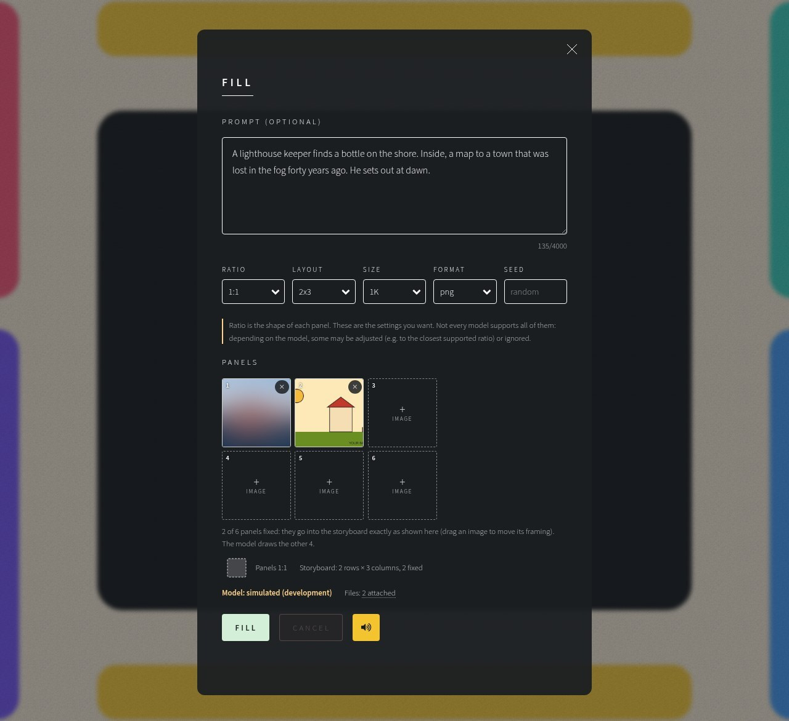
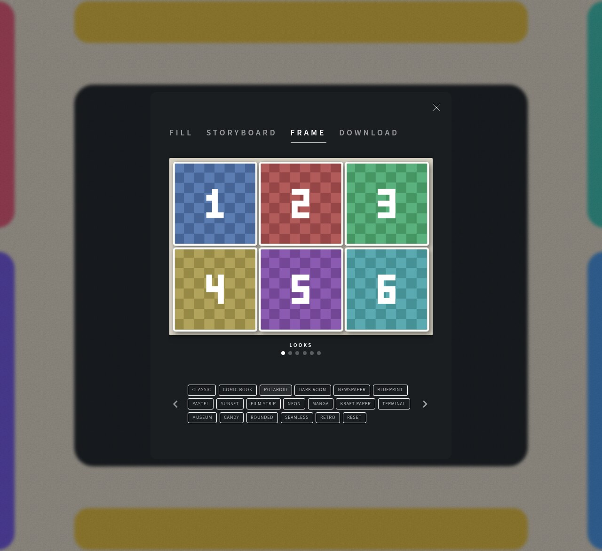
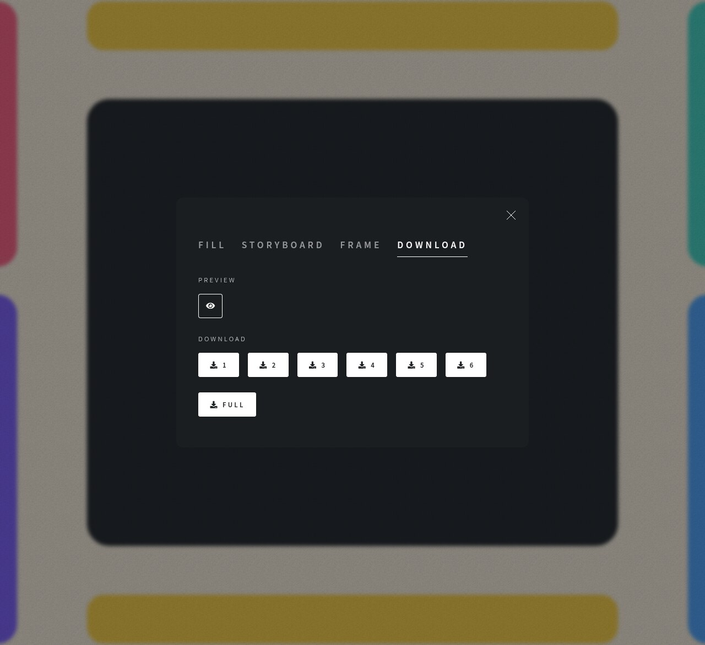

# StoryGapBoard

🎬 Turn a short story, plus optional notes, reference images and panels of your own, into a **storyboard**:
one image with a grid of panels, made by an image model on [OpenRouter](https://openrouter.ai) or
[OpenAI](https://developers.openai.com/api/docs/guides/image-generation). Then
retouch any detail of one panel without touching the rest. Visitors use their own API key.


## ✨ Features

- ✍️ **Fill**: optional story (empty = the model completes it from your panels), layout (1x3 to 3x2),
  panel ratio, size, format and seed.
- 🧩 **Panels**: the layout as boxes; drop your own image in some (drag to frame it) and the model draws
  the rest.
- 🖼️ **Storyboard**: every panel in the chosen shape. Drag to reframe, retouch a panel, undo/redo. The Download tab saves one panel or the whole board.
- 🎨 **Frame**: dress the storyboard: 12 ready-made looks, background (color, gradients, patterns), margin and
  gaps, outer frame, title, and each panel's border (color, line style, thickness), rounded corners, shadow and
  number badge. Live preview; the storyboard follows every change.
- 🖌️ **Retouch**: mark a detail (circle, rectangle or brush), say what to change; only that area is
  blended in, in the browser. Undo/redo per panel, and a draggable divider compares before and after.
- 🤖 **Model**: OpenRouter or OpenAI, with your key. 📎 **Files**: up to 5 (5 MB each): `.txt`/`.md` as
  context, PNG/JPEG/WebP/GIF as references.

🧭 **How it works**: the full pipeline (diagrams and every step with an example) and a walkthrough with
real files in [examples/](examples/README.md).

## 📸 Screenshots

| Fill | Files |
|---|---|
|  |  |
| **Model** | **Storyboard** |
|  |  |
| **Retouch** | **Frame** |
|  |  |
| **Download** | **About** |
|  |  |
---
<p align="center"><b>Mobile View</b></p>
<p align="center"></p>

## 🔒 Privacy & security

- 🔑 The API key lives only in the open tab: never stored, never logged.
- 🧠 Files and images are processed in memory, never saved (the development debug dump below cannot
  turn on in production).
- 📊 The server keeps a private generation log with hashed IDs only (no keys, no raw IPs).
- 🛡️ Rate limits, one running generation per visitor, lock after repeated bad keys, strict security headers.

## 🚀 Run locally

Deploy and run with:
```bash
python3 -m venv .venv
.venv/bin/pip install -r backend/requirements.txt
cd frontend && npm ci && npm run build && cd ..
cd backend && DATA_DIR=../data ../.venv/bin/uvicorn app.main:app --port 8080
```
> Or using [devkit](https://github.com/krosct/devkit): (`deploy.conf` is needed)
```bash
~/Documentos/devkit/deploy.sh local
# http://localhost:8080 (Ctrl+C stops it)
```

It creates `.env` from `.env.example` the first time, sets up `.venv`,
builds the frontend and serves the app. The generation log goes to `./data`.

## 📦 Deploy

GitHub Actions tests every push; it builds and publishes with health check, automatic rollback and HTTPS through the server.

### Settings

Every setting is optional; the default is used when it is not set. Locally, export them before the
`uvicorn` command. On GitHub, each one is a `DEPLOY_<NAME>` value (see the `env` input of the deploy job in
`.github/workflows/ci-cd.yml`).

| Variable | Default | Description |
|---|---|---|
| `CONTACT_EMAIL` | empty | Address for bug reports and feedback in the download window. The link is hidden when empty. |
| `LOG_HASH_SALT` | random at each start | Salt of the hashed ids in the server log. Set it to keep abuse checks consistent across restarts. |
| `RATE_API_PER_MINUTE` | `120` | API requests per minute and client IP. |
| `RATE_GENERATE_PER_MINUTE` | `4` | Generations per minute and client IP (a retouch counts as one). |
| `RATE_GENERATE_PER_DAY` | `100` | Generations per day and client IP. |
| `MAX_JOBS_PER_CLIENT` | `1` | Jobs running at the same time for one client. |
| `MAX_CONCURRENT_JOBS` | `4` | Jobs running at the same time for the whole server. |
| `AUTH_FAILURES_BEFORE_LOCK` | `5` | Rejected API keys before a client is locked out. |
| `AUTH_FAILURE_WINDOW_S` | `900` | Seconds in which rejected keys are counted. |
| `AUTH_LOCK_S` | `1800` | Seconds a locked client must wait. |
| `JOB_TTL_S` | `900` | Seconds a finished job and its image stay in memory. |
| `MAX_STORED_JOBS` | `64` | Finished jobs kept in memory. |
| `DATA_DIR` | `data` | Folder of the generation log, relative to where the app starts (`backend/` in the commands above). |
| `FRONTEND_DIST` | `frontend/dist` | Built frontend that the app serves. |
| `PUBLIC_URL` | empty | Public address of the site, sent to OpenRouter as `HTTP-Referer`. Setting it turns the two development options below off. |
| `DEBUG_DUMP_DIR` | empty (off) | Development only: keeps each job's request, images and raw answer in this folder. Ignored when `PUBLIC_URL` is set. |
| `DEBUG_FAKE_MODEL` | `0` (off) | Development only: a simulated model, so the whole flow works without a provider or key. Ignored when `PUBLIC_URL` is set. |

## 🛠️ Development

```bash
python3 -m venv .venv && .venv/bin/pip install -r backend/requirements-dev.txt
cd backend && ../.venv/bin/python -m unittest discover -s tests -t .   # tests
../.venv/bin/uvicorn app.main:app --reload                              # API on :8000
cd ../frontend && npm install && npm run dev                            # UI on :5173
```

Two settings for local development only, in `.env` (both are ignored whenever `PUBLIC_URL` is set, as
on the server, so they can never turn on in production):

- 🧪 `DEBUG_FAKE_MODEL=1`: a simulated model. Generations and retouches return test images instantly,
  for free, without any key: handy to work on the panels, the retouch window or the blend.
- 🔍 `DEBUG_DUMP_DIR=data/debug`: every job gets a folder with what was sent (final prompt, parameters,
  images; never the key), the model's raw answer, and what the browser made of it (board, retouch mask,
  blended panel).

## 🙏 Credits

StoryGapBoard created by [Gabriel Monteiro](https://krosct.github.io/).

Design: [Dimension by HTML5 UP](https://html5up.net) (CCA 3.0, see `LICENSE.txt`). Icons: Font Awesome Free.
