# How StoryGapBoard works

This page explains the whole pipeline, from what the visitor types to the final storyboard after
retouches. The second half follows one real storyboard through every step, with the files the app
actually produced.

- [The pipeline](#the-pipeline): the big picture, then each stage with a small example.
- [Walkthrough with real files](#walkthrough-with-real-files): one storyboard, start to finish.

---

## The pipeline

### The big picture

Three actors take part. The **browser** does all the image work: plan, layout guide, cutting,
composing, framing, masks, blending and the final file. The **server** validates, builds the prompt,
talks to the provider and keeps nothing on disk. The **model** (OpenRouter or OpenAI, with the
visitor's own key) draws one image per request.

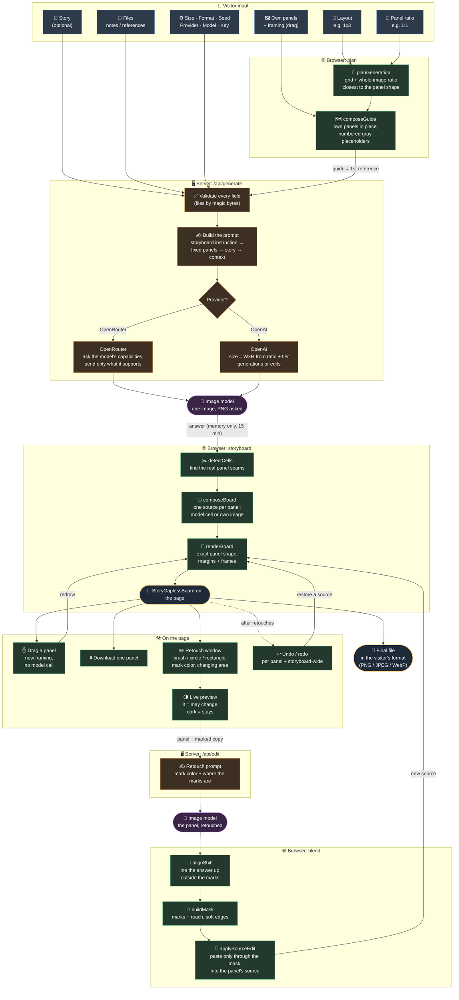

The same flow over time: who talks to whom, and when.

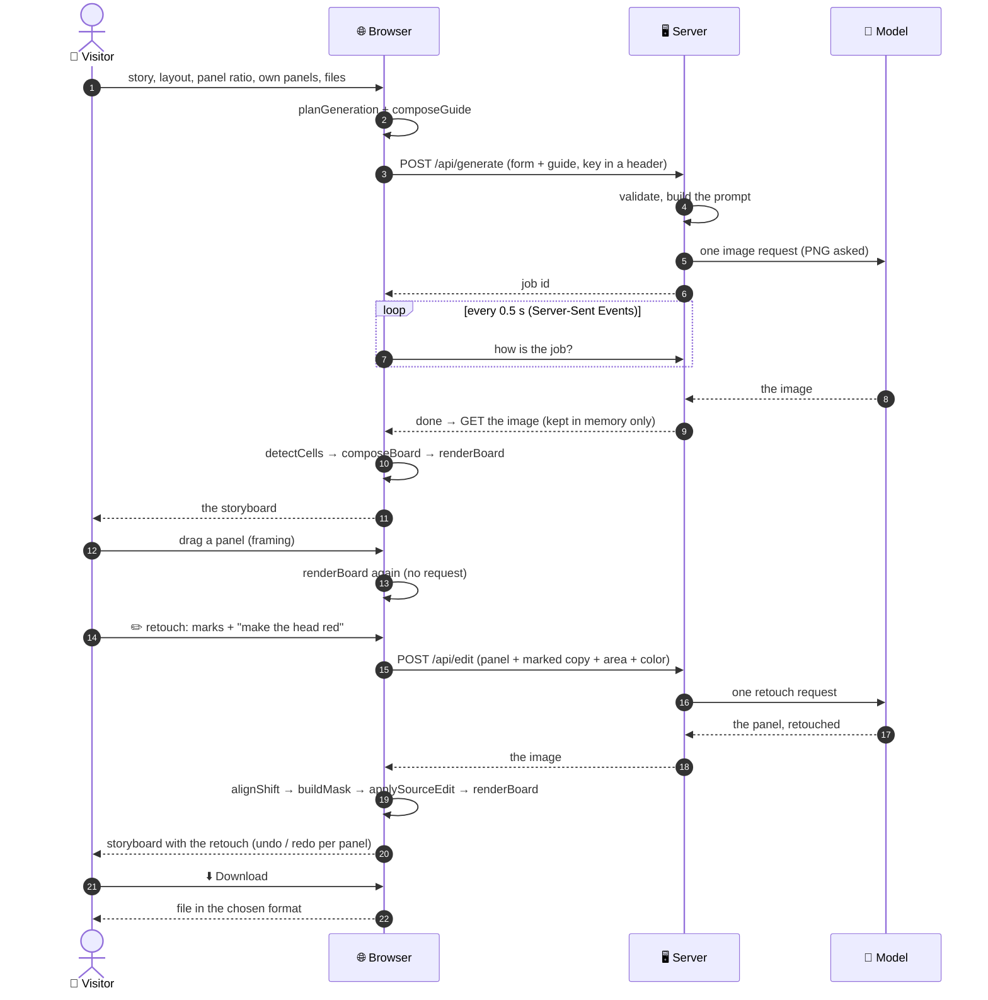

### Step by step

#### 1. The visitor's input

Everything starts on the Fill page.

- **Layout:** the grid, rows × columns.
- **Ratio:** the shape of **each panel**, not of the whole storyboard.
- **Story:** optional. When it is empty, the model works the story out from the panels.
- **Own panels:** the visitor can drop images in some boxes. They are used **pixel for pixel**,
  and when an image's shape differs from the panel's, the visitor drags it to pick the framing.
- **Files:** notes (`.txt`/`.md`) become context in the prompt; images become visual references.

> **Example:** layout `1x3`, ratio `1:1`, a 4:3 drawing in panel 1 (dragged to keep its right part),
> a square drawing in panel 3, panel 2 empty. The model only has to draw panel 2.

#### 2. The plan: which image to ask for

The model draws **one image with every panel inside**. Models only make a few image ratios, so the
browser (`planGeneration`) tries every grid with the same number of panels, combined with every
common ratio, and keeps the combination whose panels come closest to the chosen shape. The
visitor's own grid wins unless another one is clearly better.

> **Example:** 6 square panels in `1x6` would need a 6:1 image, which no model makes. Asked as
> `1x6` at 21:9, each panel would come out 0.39:1, tall and thin. Asked as `2x3` at 3:2, each panel
> is exactly 1:1. So the model is asked for 2 rows × 3 columns, and the browser lays the six panels
> out in a row afterwards, in the same reading order.

#### 3. The layout guide

When the visitor gave own panels, the browser draws a **layout guide** (`composeGuide`). It is the
model's grid, with the visitor's panels in place (with their framing) and numbered gray
placeholders where the model has to draw. It is sent as the **first** reference image, so it is
kept even when a model accepts few references.

> **Example:** a 21:9 guide with the house in cell 1, a gray "2" in cell 2 and the flower in cell 3.

#### 4. The request, on the server

The server validates every field again (images by their bytes, not their name) and builds the
prompt in a fixed order:

1. the storyboard instruction ("exactly 1 row and 3 columns… edge to edge, no borders");
2. which panels are finished and which to draw;
3. the story (or "infer it from the finished panels");
4. the context from the notes.

Then each provider gets what it understands:

- **OpenRouter:** the server first asks which parameters the model supports (ratio, size, seed,
  format) and sends only those, adjusted to the model's own values. A wish the model cannot take as
  a parameter goes into the prompt as a sentence.
- **OpenAI:** the ratio and the size tier become one `size` in pixels. The image goes to
  `/images/generations`, or to `/images/edits` when there are input images (guide, references).
- **Always PNG:** the model is always asked for a lossless PNG, when it supports the format
  parameter. The visitor's format only matters for the final file, which the browser encodes.

> **Example (OpenAI):** 16:9 at "1K" → about one megapixel in that shape →
> `size: 1360x768` (both multiples of 16, as OpenAI requires).

#### 5. The answer and the job

The request runs as a **job**: the browser gets a job id right away and follows it with
Server-Sent Events until it ends (done, error or cancelled). The image is kept **in memory only**,
for a few minutes, so the browser can fetch it. Nothing is written to disk. The only exception is
the local development debug dump, and it can never turn on in production.

> **Example:** while it runs, a clock and a spinner show the wait. At the end, one line:
> "Done in 1.1s (created in 0.8s)". The first time is the whole wait in the browser; the second is
> the model's own time, measured by the server.

#### 6. Cutting the panels out

Models do not always split the image evenly, and some draw their own borders. A plain cut into
equal parts would take a slice of the neighbor panel. So `detectCells` looks for the **seams**:
lines or bands that cross the whole image near each expected boundary. It cuts there and drops a
small margin.

> **Example:** the model made panel 2 narrower than a third of the width and drew black borders.
> An even cut would include the borders and slices of panels 1 and 3; the detected cut gets
> panel 2 only.

#### 7. Composing the storyboard

`composeBoard` rebuilds the **visitor's** layout. Each panel gets a **source**:

- a panel the model drew: its cell in the model's answer;
- a panel the visitor gave: their original image, with their framing (the model's rough copy of it
  is thrown away).

`renderBoard` then draws every source **cover-fitted to the exact panel shape**, with a white margin
and a thin dark frame around each panel. The **Frame** tab restyles that same board (background,
margins, borders, corners, shadow, numbers, ready-made looks) and redraws it from the sources, with no
model call (see [step 12](#12-framing-the-storyboard)).

> **Example:** the model's panel 2 came out 0.6:1 but the panel is 1:1. It is scaled to fill the
> square, and a bit of its top and bottom is cropped.

#### 8. On the page: framing and downloads

Because the board keeps the **sources**, not just a flat picture, any panel can still be dragged,
or moved with the arrow keys, to change its framing. That only redraws the board: no model call
and no cost. While a panel is held, its label and buttons hide, so the framing is fully visible.
Each panel also has a pencil button (retouch). Downloads are in the Download tab, see [step 13](#13-the-final-file).

> **Example:** the model put a character's head too close to the top of the frame: drag the panel
> down a little and the head comes back into view.

#### 9. Marking a retouch

The pencil opens the retouch window for that panel. The marks tell what may change:

| Tool | What counts |
|---|---|
| ⭕ Circle / ⬜ Rectangle | everything inside the shape |
| 🖌️ Brush (thin / medium / thick) | **only** what it paints, never the inside of a loop |

- **Mark color:** picked automatically, the one that stands out most on the panel (red marks on a
  red drawing would be hard for the model to see). The visitor can change it.
- **Changing area:** how far the change may reach.
  - *Only the marked area*: just the marks.
  - *Marked area and around it*: the marks plus a soft margin (the default).
  - *The whole panel*: everything in the panel may change.
- **Live preview:** whatever may change stays lit, and the rest of the panel is darkened. The
  visitor sees the result of every choice before sending anything.

> **Example:** a brush stroke drawn as a "U" around a head lights only the stroke, so a hat drawn
> inside the "U" would be dropped. A circle around the head lights the whole head.

#### 10. The retouch request

Only **this panel** is sent, never the whole storyboard, as two images: the panel as it is, and a
copy with the marks. The prompt names the mark color, says that the marks are only a pointer,
asks for a clear change there, and also says in words where the marks are, for models that look at
them less carefully. OpenAI gets the panel's **exact** shape as `size`.

> **Example:** "The marked area is in the middle left of the panel, spanning about 19-45% of its
> width (from the left) and 24-45% of its height (from the top)."

#### 11. Blending the retouch

Models redraw the whole panel and often move things a few pixels, or change things nobody asked
for. So the browser does three things:

1. **Line it up (`alignShift`):** it looks for the small shift that makes the model's answer match
   the panel **outside the marks**, so the old picture does not show through the soft edge.
2. **Build the mask (`buildMask`):** from the marks and the chosen changing area, with soft edges.
3. **Paste through the mask (`applySourceEdit`):** only what is inside the mask is pasted, into the
   panel's **source**, so the panel can still be dragged afterwards. Everything outside stays
   byte for byte.

> **Example:** the model made the head red, as asked, but also turned the leaves yellow. The leaves
> are outside the mask, so they stay green in the storyboard.

#### 12. Undo, redo and starting over

- **Per panel:** each panel keeps its own retouch history. In a panel's window, undo and redo only
  touch that panel, and they keep its current framing.
- **Storyboard-wide:** the buttons under the storyboard undo the latest retouch, whatever the panel.
- **Starting over:** a new generation replaces the storyboard, so the app asks first: "Replace the
  storyboard? The current one will be lost." The dialog also offers a download.

> **Example:** retouch panel 1, then panel 2. In panel 1's window, undo brings panel 1 back and
> leaves panel 2 retouched.

#### 13. The final file

The download is encoded by the browser in the chosen format (PNG, JPEG or WebP), straight from the
current board, framed or not. The Download tab offers a preview at full size, each panel on its own, or
the full storyboard. The server never sees the final storyboard.

---

## Walkthrough with real files

One small storyboard followed from start to finish. Everything here was produced by the app's own
code, running in a browser. Only the **model's answers** (steps 4 and 9) are simulated drawings, so
the example costs nothing. They are imperfect on purpose, in the same ways real models are, to show
how each step copes. The requests and answers were captured by the app's development debug dump.

**The story:** *Pip the robot finds a tiny sprout, waters it at noon, and at night it has bloomed.*
**Settings:** layout `1x3` (1 row, 3 columns), ratio `1:1` (the shape of **each panel**).

### 1. The visitor's own panels

The visitor has drawn the first and the last moments. Panel 2 is left for the model.

| Panel 1 (4:3 image) | Panel 3 (1:1 image) |
|---|---|
| 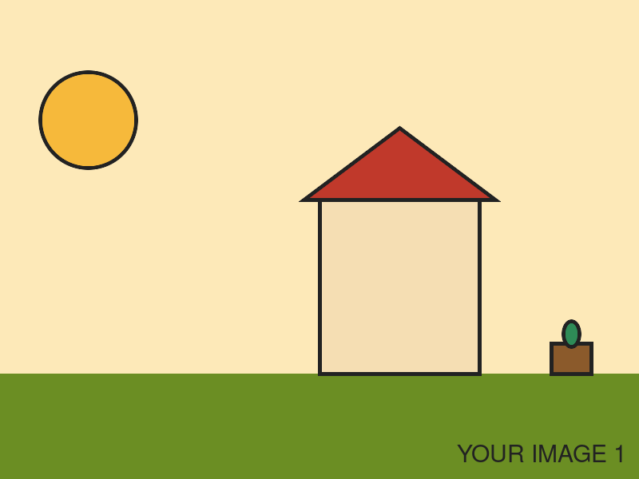 | 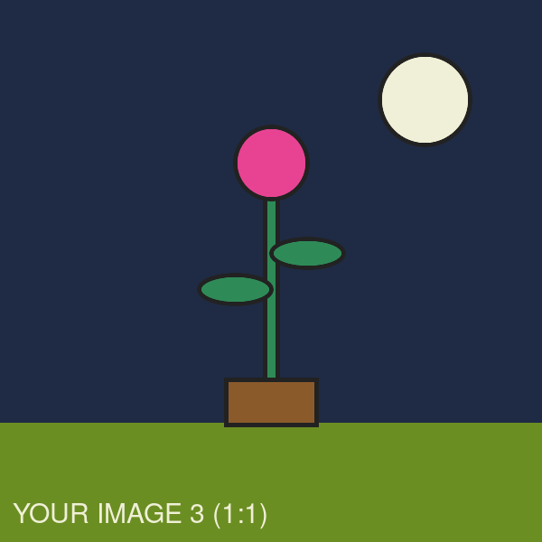 |

### 2. The Panels preview

The boxes have the chosen panel shape (1:1). Image 3 is already square, so it fits as it is, with
no crop. Image 1 is 4:3, so part of it has to go: the visitor moved it (dragging, or here with the
arrow keys) to keep the house and the sprout. The storyboard uses exactly this framing.

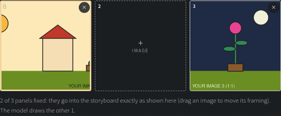

### 3. What is sent to the model

**The plan.** 3:1 is not a ratio models make, so `planGeneration` picks the closest common one:

```json
{ "layout": "1x3", "genLayout": "1x3", "boardAspect": "21:9", "panelRatio": 1 }
```

So the model is asked for one 21:9 image holding 1 row of 3 panels. Those panels come out a bit
taller than square (about 0.78:1), and the browser fixes that in step 6.

**The layout guide** is sent as the FIRST reference image:

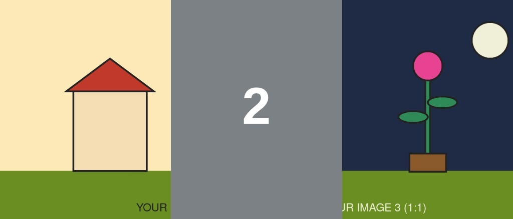

**The prompt** ([03-prompt-generate.txt](03-prompt-generate.txt)) starts with the storyboard
instruction, says that panels 1 and 3 are finished and panel 2 has to be drawn, and ends with the
story. In this example the model (on OpenRouter) declares only the ratio as a parameter, so the
request carries `aspect_ratio: 21:9`, and the size wish goes into the prompt as a sentence.

### 4. The model's answer (simulated)

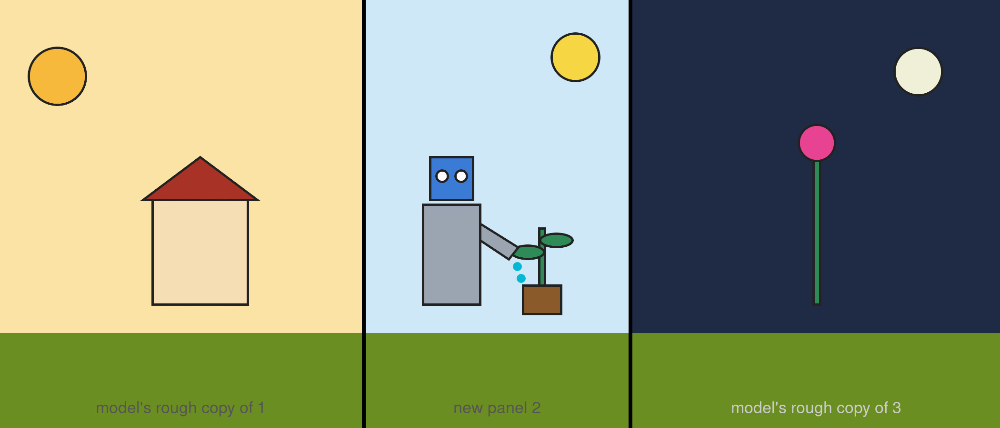

A typical imperfect answer:

- It redraws panels 1 and 3 only roughly. That does not matter: they are thrown away and the
  visitor's originals are used.
- Panel 2 came out **narrower** than a third of the width.
- It drew its **own black borders**, although it was asked for none.

### 5. Cutting the panels out

The red dashes are an even split into thirds. The green box is the cut kept for panel 2, the one the model drew (panels 1 and 3 are the visitor's own images, so the model's cuts there are not used):

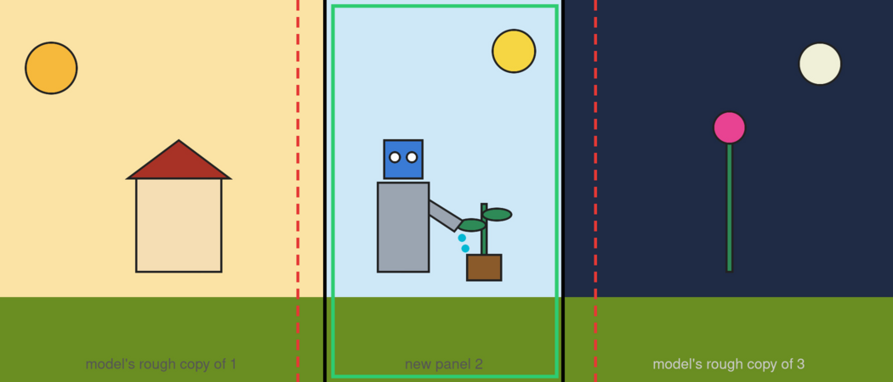

What panel 2 would look like with each cut:

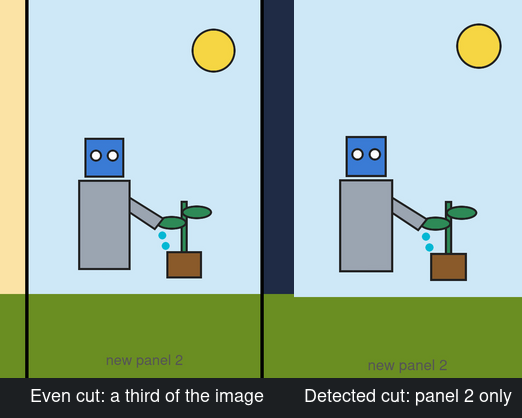

### 6. The final storyboard

Every panel is exactly 1:1. The model's panel 2 is cover-fitted into its square. Panels 1 and 3
are the visitor's original images, with the framing from step 2. A white margin and a thin dark
frame separate the panels.

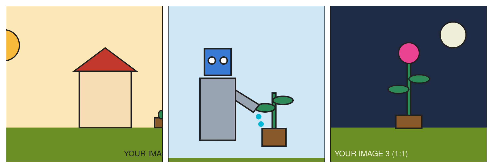

On the page, with the mouse over panel 2: its pencil button (retouch). Under the storyboard, the undo and
redo buttons. Downloads live in the Download tab ([step 13](#13-the-final-file)):

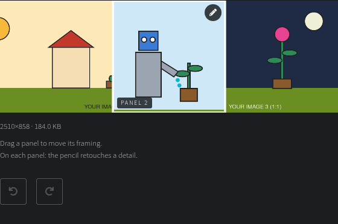

### 7. Retouching panel 2

The pencil on panel 2 opens the retouch window. The visitor paints over the robot's head with the
brush and asks *"make the robot's head red"*. The **Changing area** is left on "Marked area and
around it". The mark color came out **yellow** automatically: the panel is light blue and already
has red and green in it. The lit part is what may change; the rest is darkened.

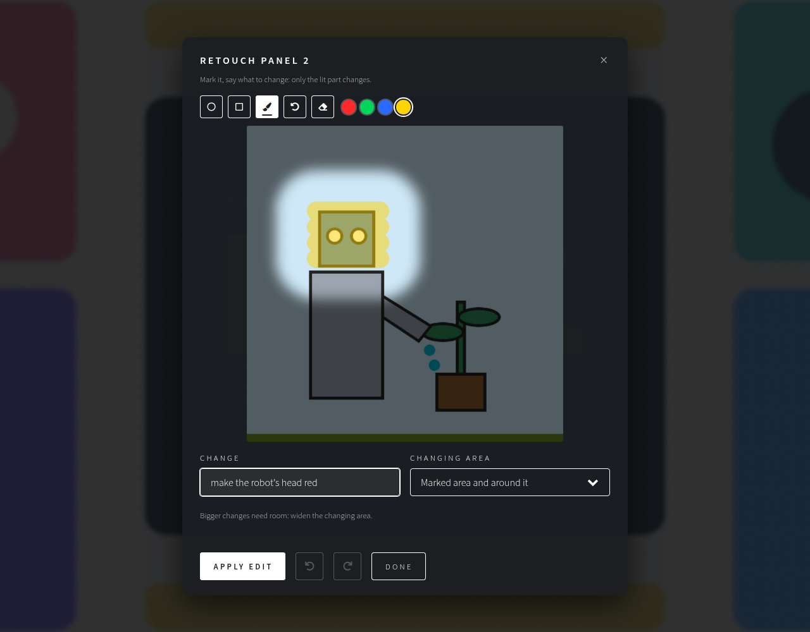

The same marks with each **Changing area** option, as the preview shows them:

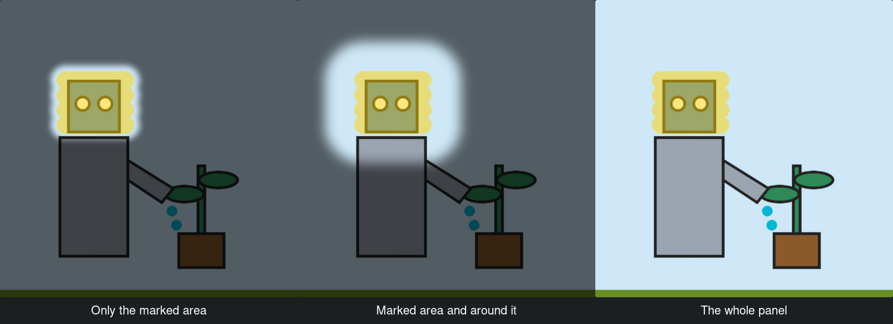

### 8. What is sent for a retouch

Only this one panel is sent, as two images:

| Reference 1: the panel as it is | Reference 2: the same panel with the yellow marks |
|---|---|
| 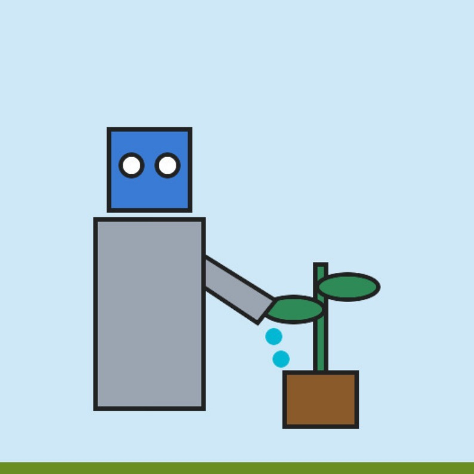 | 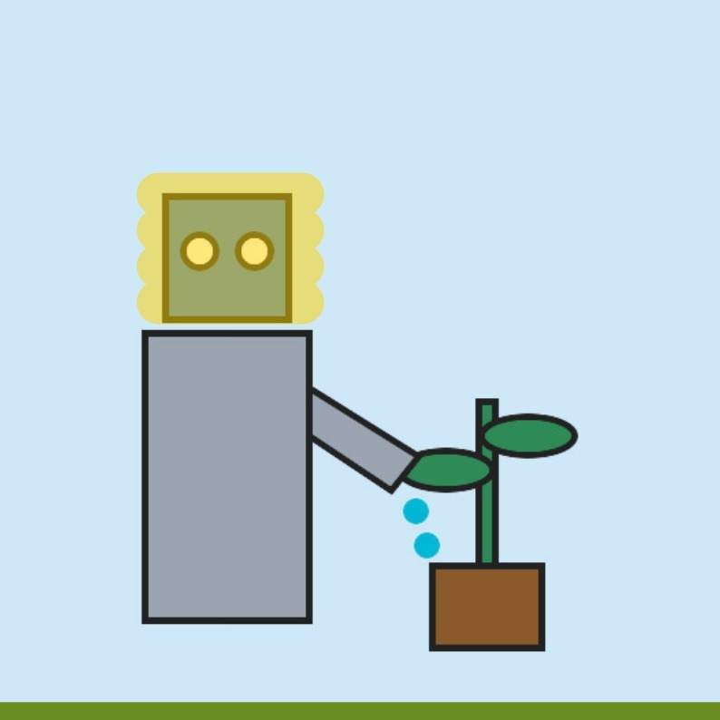 |

The prompt ([08-prompt-retouch.txt](08-prompt-retouch.txt)) names the mark color, says it is only a
pointer, asks for a clear change inside the marks, and says in words where the marks are ("middle
left, about 19-45% of its width…").

### 9. The model's retouch (simulated)

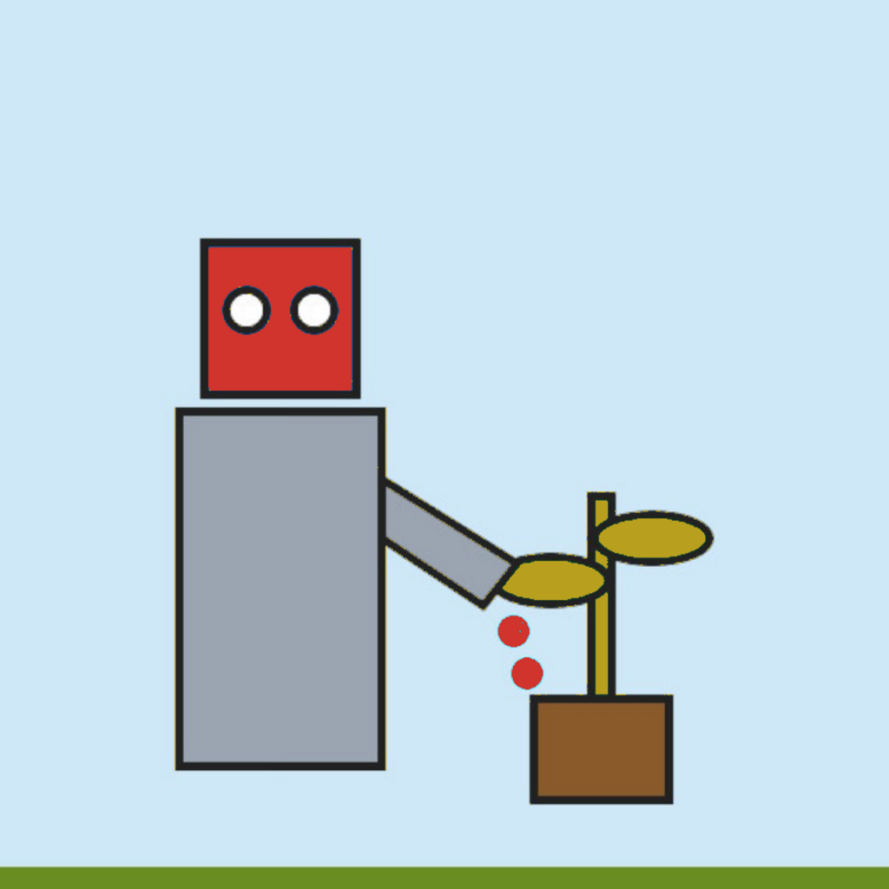

The head is red, as asked. But, like real models often do, it also changed something nobody asked
for: the leaves turned yellow. It also answered at a different size (1024×1024 instead of 794×794).

### 10. Blending only where it was allowed

The **mask** comes from the brush stroke, grown by the "around it" reach, with soft edges
(white = may change). The model's answer is lined up with the panel, stretched back to its size, and
**only the part inside the mask** is pasted. The checkerboard shows what is left out:

| Mask | What is pasted |
|---|---|
| 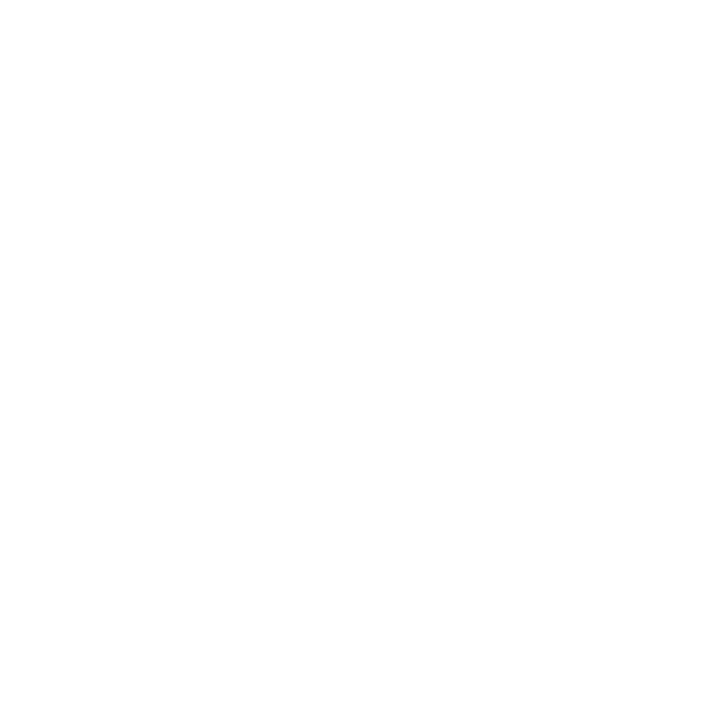 | 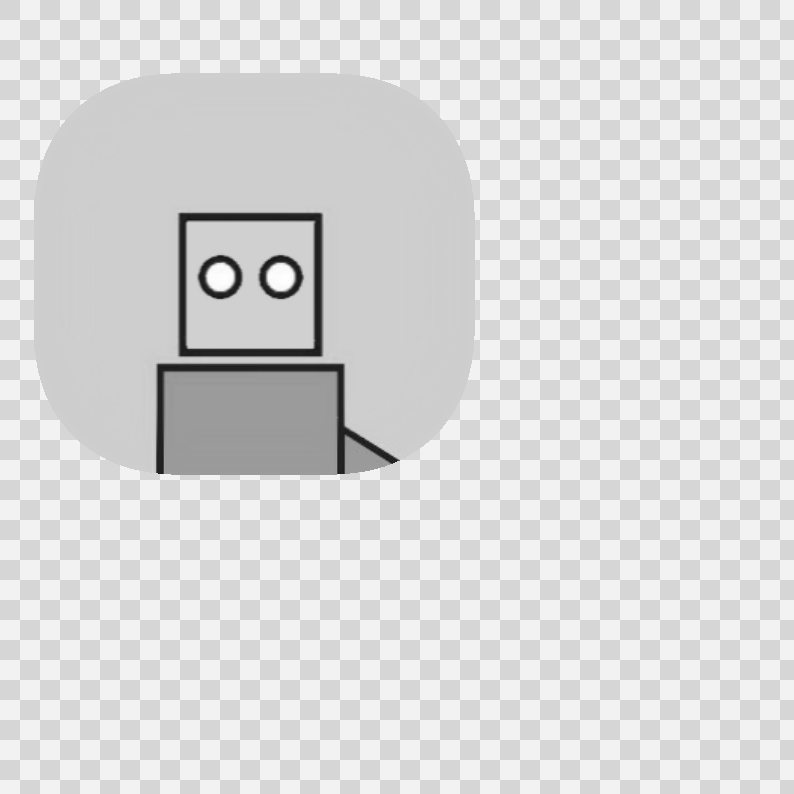 |

### 11. The storyboard after the retouch

The head is red. The yellow leaves are gone, because they were outside the mask. Panels 1 and 3,
and every pixel of panel 2 outside the mask, did not change. In panel 2's window, undo brings back
the blue head, and redo applies the retouch again.

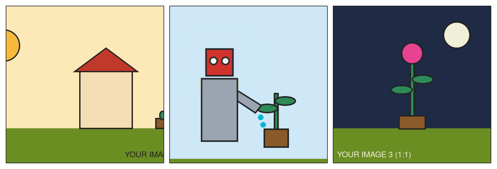

### 12. Framing the storyboard

The **Frame** tab restyles the board without asking the model again. The **Polaroid** look is picked
here from the ready-made looks; the other sections (background, margin and gaps, outer frame, title,
panel border, corners and shadow, numbers) sit under the same tab, one card each, under the preview.

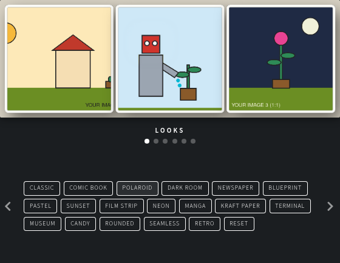

The same storyboard, redrawn from its sources with the look applied:


### 13. The final file

The **Download** tab has a preview at full size, one button per panel, and the whole storyboard. Each
download first shows a short notice asking the visitor to share the site; the file is then made in the
browser from the current board. Here, the framed storyboard saved as PNG:

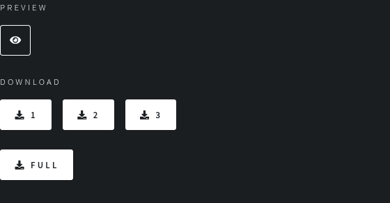

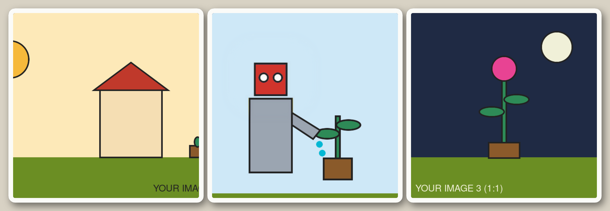

